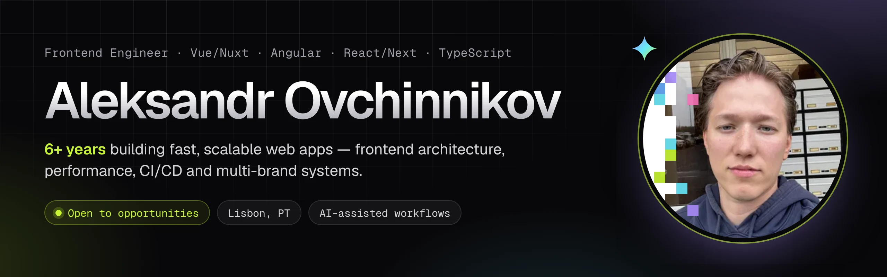

  
  
  
  

### ✦ About

Frontend Engineer with **6+ years** of experience building production web applications with **Vue/Nuxt, Angular and TypeScript**. Strong background in frontend architecture, performance optimization, CI/CD and scalable multi-brand systems. I use AI-assisted workflows as a force multiplier, not a replacement for engineering judgement — and I'm currently expanding my stack with React and Next.js through hands-on projects.

🟢 **Open to new opportunities** · 📍 Oeiras, Lisbon area, Portugal · Portugal residence permit — no relocation needed

### ✦ Now

**[BrainRocket](https://www.brainrocket.com/)** — Frontend Developer (Angular), 2025 – present

- Built an AI-assisted development infrastructure around **Claude Code** (custom skills, project rules, structured docs) — feature delivery up to **3× faster**.
- Refactored the shared UI system and optimized rendering performance by up to **3×**.
- Pixel-perfect, responsive interfaces with complex animations and unconventional visual concepts.

### ✦ Highlights

- **Wintech** (2023 – 2025, Deputy Head of Frontend) — Nuxt 2 → Nuxt 3 migration on Nuxt layers; **2.5×** faster pages with hybrid rendering, SWR caching and Redis revalidation; one build for all brands cut releases from hours to **10 minutes**; acted as Head of Frontend.
- **IdaLite** (2020 – 2023) — website builder with **500+** customizable blocks, a styleless UI library, customer account platform, interactive real-estate maps.

### ✦ Stack

  
  
  
  
  
  
  
  
  
  
  
  
  
  
  
  
  
  
  

### ✦ Activity

<picture>
  <source media="(prefers-color-scheme: dark)" srcset="https://raw.githubusercontent.com/ovchinnikov-lxs/ovchinnikov-lxs/output/snake-dark.svg" />
  <source media="(prefers-color-scheme: light)" srcset="https://raw.githubusercontent.com/ovchinnikov-lxs/ovchinnikov-lxs/output/snake.svg" />
  
</picture>

✦ <a href="https://ovchinnikov-lxs.github.io">ovchinnikov-lxs.github.io</a> — scratch the plain page to reveal the design ✦

