  &nbsp;
  &nbsp;
  &nbsp;
  &nbsp;
  &nbsp;
  

### ✦ Now

Frontend architecture and performance first, pixel-perfect UI on top:

- **Multi-brand platforms** on shared layers — one codebase, many branded sites.
- **2.5× faster pages** with hybrid rendering and SWR caching.
- **Releases in 10 minutes instead of hours** — one build for all brands, each brand's config applied at runtime.
- **Up to 3× faster rendering** after refactoring a shared UI system.
- **AI-assisted workflows** around Claude Code — feature delivery up to 3× faster.

Currently expanding into React & Next.js — my [portfolio](https://ovchinnikov-lxs.github.io) is one of those projects: scratch the plain page to reveal the design.

### ✦ Stack

### ✦ Activity

<picture>
  <source media="(prefers-color-scheme: dark)" srcset="https://raw.githubusercontent.com/ovchinnikov-lxs/ovchinnikov-lxs/output/snake-dark.svg" />
  <source media="(prefers-color-scheme: light)" srcset="https://raw.githubusercontent.com/ovchinnikov-lxs/ovchinnikov-lxs/output/snake.svg" />
  
</picture>

The card above refreshes daily via GitHub Actions (`scripts/neofetch.mjs`). Font: Geist Mono, SIL Open Font License 1.1.
