  &nbsp;
  &nbsp;
  &nbsp;
  &nbsp;
  &nbsp;
  

### ✦ About

Frontend Engineer with 6+ years of experience building production web applications with Vue/Nuxt, Angular, and TypeScript. Strong background in frontend architecture, performance optimization, CI/CD, and scalable multi-brand systems. I build AI-assisted workflows to improve development speed and consistency.

Currently expanding my stack with React and Next.js through hands-on projects — my [portfolio](https://ovchinnikov-lxs.github.io/?ref=github) is one of them.

### ✦ Projects

**[PetPoint](https://pet-point.app)** — SaaS CRM for grooming businesses: multi-tenant CRM, salon websites with online booking, Stripe subscriptions, 4 languages. Built in 18 days — ~72k lines of TypeScript, 2,190+ tests, 50 migrations, 156 issues closed — by an AI-native team I direct: role-scoped Claude Code sessions and subagents working under my architecture, rules and test-first Definition of Done.
 Next.js · TypeScript · tRPC · Drizzle · PostgreSQL · Stripe · Playwright

**[Convert Any](https://convert-any-one.vercel.app)** · [repo](https://github.com/ovchinnikov-lxs/convert-any) — image, video and document converter that runs entirely in the browser: ffmpeg.wasm, libheif and libvips in WebAssembly, multi-threaded, offline PWA. Nothing is uploaded.
 React · TypeScript · Vite · WebAssembly

### ✦ Stack

### ✦ Activity

<picture>
  <source media="(prefers-color-scheme: dark)" srcset="https://raw.githubusercontent.com/ovchinnikov-lxs/ovchinnikov-lxs/output/snake-dark.svg" />
  <source media="(prefers-color-scheme: light)" srcset="https://raw.githubusercontent.com/ovchinnikov-lxs/ovchinnikov-lxs/output/snake.svg" />
  
</picture>

The card above refreshes daily via GitHub Actions (`scripts/neofetch.mjs`). Font: Geist Mono, SIL Open Font License 1.1.
